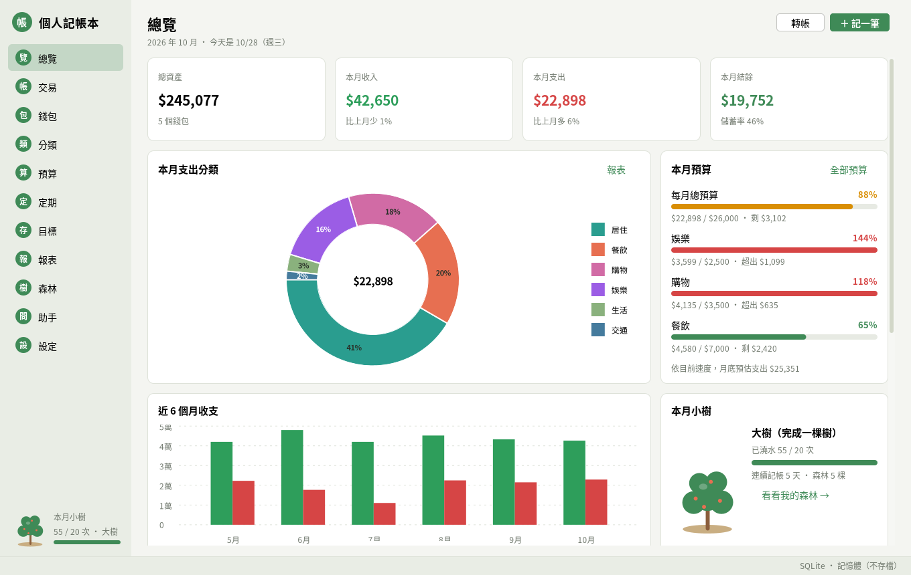
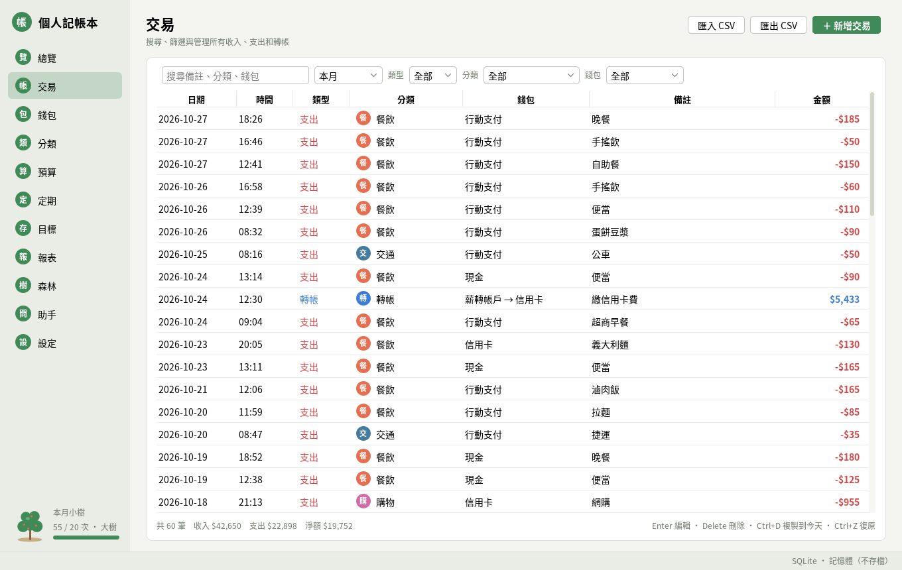
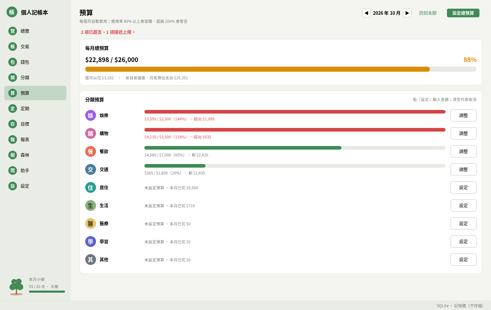
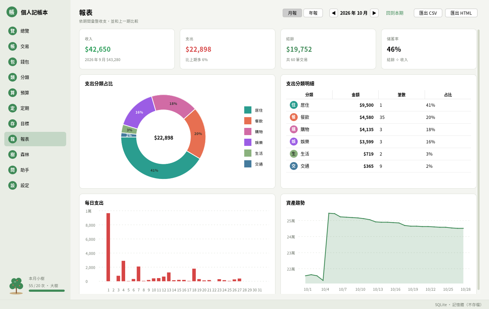
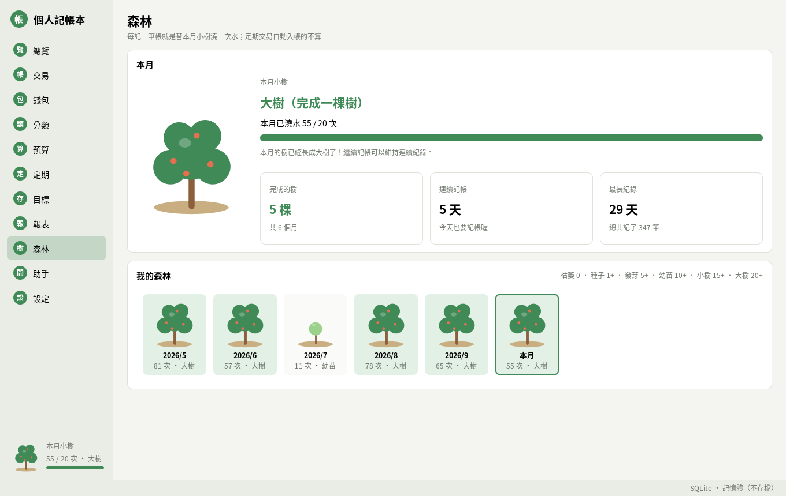
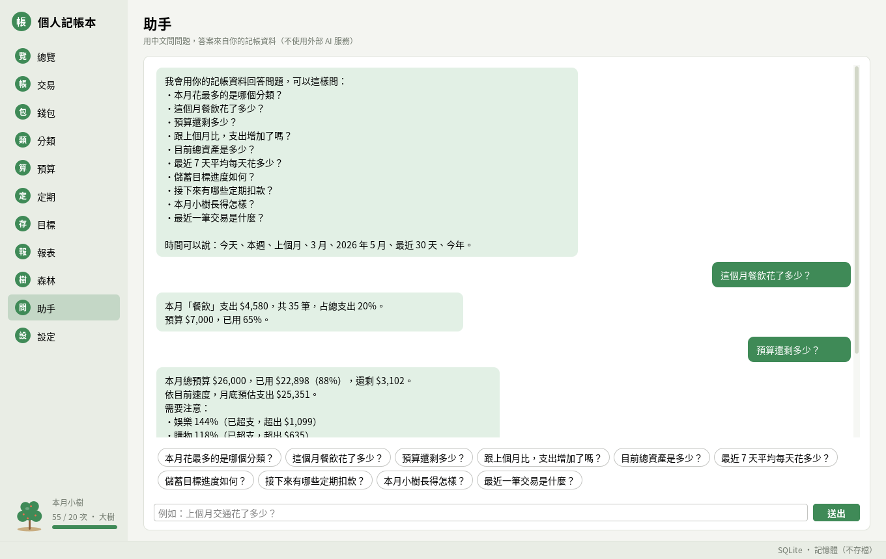
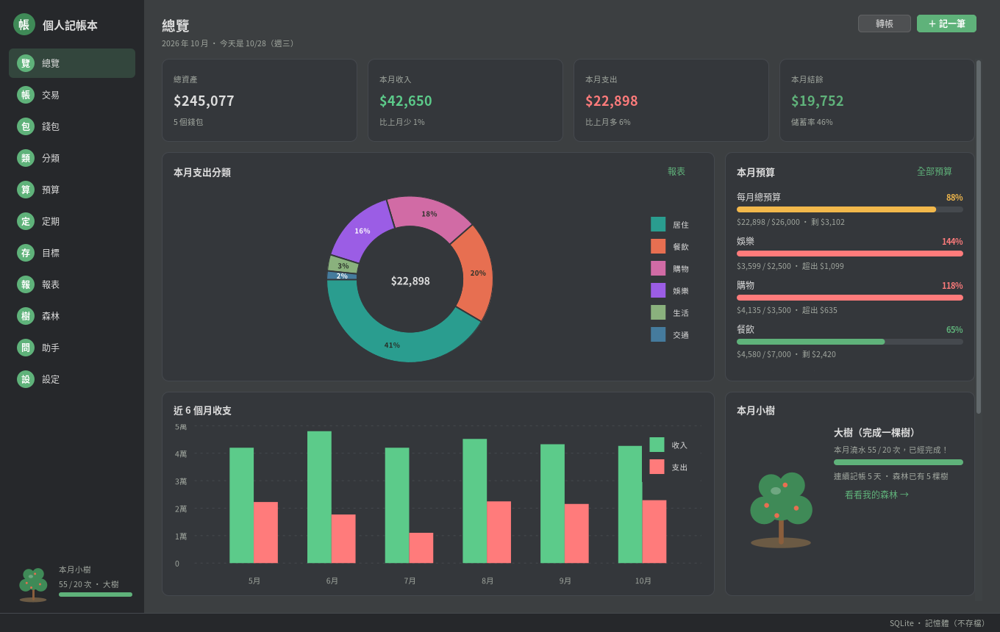

# Personal Budget Book 個人記帳本

臺大 114-2 物件導向程式語言（黃乾綱老師）課程第 13 組的期末專題：用 Java Swing 寫的桌面記帳程式。
同一組的另一個專題是 [OOP-G13-Library-System](https://github.com/zxc29051617/OOP-G13-Library-System)。

組員：[b13204013](https://github.com/b13204013)、[NTU-B13204043](https://github.com/NTU-B13204043)、[zxc29051617](https://github.com/zxc29051617)

原始版本是第 13 組在課堂上繳交的作品（Java Swing + MySQL，手機 App 風格的介面），
書面報告、簡報與介面設計放在 [`docs/course/`](docs/course/)，繳交時的程式碼保留在 tag
[`course-submission`](https://github.com/zxc29051617/OOP-G13-Personal-Budget-Book/tree/course-submission)。
目前的版本是課程結束後的延伸改版：保留原版的記帳流程與種樹激勵機制，依原報告「限制與未來改進」一節的方向，
改成分層架構、內建資料庫，並加入預算、定期交易、報表圖表與復原等功能。



## 功能

- 總覽：總資產、本月收支與結餘、支出分類甜甜圈圖、近 6 個月收支、預算進度、本月小樹、最近交易、即將到來的定期交易與儲蓄目標
- 交易：收入、支出與錢包之間的轉帳；依關鍵字、期間、類型、分類、錢包篩選，點欄位標題排序；編輯、刪除、複製到今天
- 快速輸入：金額欄可以輸入算式（`120+45`）、備註自動完成，並依過去相同備註推薦分類
- 錢包：現金、銀行帳戶、電子支付、信用卡等，餘額由交易即時計算；可封存不再使用的錢包；近 90 天總資產趨勢
- 分類：自訂名稱、顏色與圖示文字（中文字、符號或 emoji），可以把一個分類合併到另一個
- 預算：每月總預算與各分類預算，80% 以上提醒、超過 100% 警告，並依目前花費速度預估月底支出
- 定期交易：房租、薪資、訂閱等，每天／每週／每月／每年；啟動時自動補入帳，也可以提前入帳或略過一次
- 儲蓄目標：目標金額與日期、存入與取出、計算每月需要存多少
- 報表：月報與年報（收支摘要、與上期比較、分類占比、每日或每月收支、資產趨勢），可匯出 CSV 或 HTML
- CSV 匯入與匯出：UTF-8（Excel 可直接開啟），匯入時自動建立缺少的錢包與分類並略過重複的交易
- 種樹與森林：每記一筆帳就是替本月小樹澆一次水，每月 20 次長成大樹、0 次枯萎；過去每個月的樹排成森林，並記錄連續記帳天數
- 查詢助手：用中文問「上個月餐飲花多少」「預算還剩多少」，以規則判斷問題並從自己的資料算出答案，不連線到外部服務
- 新增、修改、刪除都可以復原與重做（Ctrl+Z／Ctrl+Y），淺色與深色主題，完整的鍵盤快捷鍵，繁體中文介面
- 資料預設存在內建的 SQLite，不需要安裝資料庫；也可以改用 MySQL

## 畫面

| 交易紀錄 | 預算 |
|---|---|
|  |  |
| 報表 | 我的森林 |
|  |  |
| 查詢助手 | 深色模式 |
|  |  |

其他頁面（錢包、分類、定期交易、儲蓄目標、設定、交易輸入視窗）的截圖在 [`docs/images/`](docs/images/)。

## 與原版的差異

| 項目 | 原版（課堂繳交） | 延伸版 |
|---|---|---|
| 金額 | `double` | `Money` 值物件（`BigDecimal`），資料庫以「分」為單位的整數保存 |
| 資料庫 | 需要先安裝並啟動 MySQL | 內建 SQLite；MySQL 改為選用；schema 版本管理 |
| 分類 | 程式內固定的陣列 | 資料表儲存，可自訂顏色與圖示、合併 |
| 刪除 | 無法復原 | 新增、修改、刪除都可以復原與重做 |
| 分析 | 本月分類長條圖 | 甜甜圈圖、月／年收支、資產趨勢、月報與年報匯出 |
| 預算 | 每月總預算 | 總預算加上分類預算、超支提醒與月底預估 |
| 建置 | 手動下載 jar、用 `javac` 編譯 | Maven 打包成單一 jar、Maven Wrapper、GitHub Actions |

## 專案結構

```text
.
├── src/main/java/budgetbook/
│   ├── app/                  # 程式進入點、命令列參數、smoke test
│   ├── model/                # 不可變的資料類別：Money、Transaction、Budget……
│   ├── exception/            # 自訂例外（中文錯誤訊息）
│   ├── repository/           # Repository 介面、資料庫設定與 StorageFactory
│   │   └── jdbc/             # SQLite／MySQL 共用的 JDBC 實作與 schema 升級
│   ├── event/                # 事件匯流排（Observer）
│   ├── command/              # 可以復原的指令（Command）
│   ├── service/              # 商業邏輯：錢包、預算、定期交易、統計、種樹……
│   │   ├── report/           # 月報、年報與匯出格式（Strategy）
│   │   ├── io/               # CSV 匯入匯出
│   │   └── assistant/        # 規則式查詢助手（Chain of Responsibility）
│   └── ui/                   # Swing 介面（只呼叫 service，不含商業邏輯）
│       ├── pages/            # 總覽、交易、錢包、預算……各頁面
│       ├── forms/            # 新增與編輯的表單
│       ├── components/       # 卡片、圖表、進度條、小樹等元件
│       └── theme/            # FlatLaf 主題、顏色與字型
├── src/main/resources/db/    # 各版本的建表 SQL（sqlite、mysql）
├── src/test/java/budgetbook/ # JUnit 5 測試
├── docs/
│   ├── architecture.md       # 架構與 UML 類別圖
│   ├── design-patterns.md    # 使用的設計模式與位置
│   ├── user-guide.md         # 使用說明
│   ├── images/               # 畫面截圖
│   └── course/               # 原版課堂繳交的書面報告、簡報、介面設計與 MySQL schema
├── .github/workflows/ci.yml  # GitHub Actions：建置、測試與 smoke test
├── pom.xml                   # Maven 設定（Java 21、打包成單一 jar）
├── mvnw、mvnw.cmd            # Maven Wrapper，只有 Java 也能建置
├── run.sh、run.bat           # 啟動腳本
└── THIRD_PARTY_NOTICES.md    # 第三方函式庫與授權
```

架構、類別圖與設計模式的說明在 [`docs/architecture.md`](docs/architecture.md) 與
[`docs/design-patterns.md`](docs/design-patterns.md)，操作方式在 [`docs/user-guide.md`](docs/user-guide.md)。

## 執行環境

- Java 21 以上（JDK，例如 Eclipse Temurin 21）
- Windows、macOS 或 Linux
- 不需要另外安裝資料庫；第一次建置需要網路下載相依套件

## 執行方式

```bash
./run.sh        # macOS / Linux
run.bat         # Windows
```

第一次執行會用 Maven Wrapper 建置 `target/personal-budget-book.jar`，之後直接啟動。也可以自己建置後執行：

```bash
./mvnw -DskipTests package
java -jar target/personal-budget-book.jar
java -jar target/personal-budget-book.jar --demo   # 示範模式：載入六個月的示範資料，不會存檔
```

第一次啟動會建立預設的分類與「現金、銀行帳戶、電子支付」三個錢包，並詢問是否載入示範資料。

| 參數 | 說明 |
|---|---|
| `--demo` | 使用記憶體資料庫並載入示範資料 |
| `--db=<檔案>` | 指定 SQLite 資料庫檔案 |
| `--data-dir=<資料夾>` | 設定檔與預設資料庫的位置（預設 `~/.budgetbook`） |
| `--storage=mysql` | 改用 MySQL，搭配 `--mysql-url`、`--mysql-user`、`--mysql-password` |
| `--smoke-test` | 不開視窗，自動檢查資料庫與各項功能後結束 |
| `--help` | 顯示說明 |

## 建置與測試

```bash
./mvnw verify          # 編譯、執行 JUnit 5 測試、打包 jar、產生覆蓋率報告 target/site/jacoco/
java -Djava.awt.headless=true -jar target/personal-budget-book.jar --smoke-test
```

測試涵蓋 model、service、SQLite repository、復原與重做、CSV、報表、查詢助手，以及在沒有螢幕的環境中建立並繪製每一個頁面。
GitHub Actions 在每次 push 時執行 `mvn -B verify` 與 smoke test，並保留打包好的 jar。

MySQL 的整合測試在有 MySQL 伺服器時執行：

```bash
BUDGETBOOK_TEST_MYSQL_URL='jdbc:mysql://localhost:3306/budget_book_test?createDatabaseIfNotExist=true&allowPublicKeyRetrieval=true&useSSL=false' \
BUDGETBOOK_TEST_MYSQL_USER=root BUDGETBOOK_TEST_MYSQL_PASSWORD=密碼 ./mvnw test -Dtest=MySqlStorageTest
```

README 的截圖由測試程式在沒有螢幕的環境中產生：

```bash
./mvnw test -Dtest=ScreenshotsTest -Dscreenshots=docs/images
```

## 資料庫

預設使用內建的 SQLite，資料存在 `~/.budgetbook/budgetbook.db`（Windows 為 `C:\Users\<使用者>\.budgetbook\budgetbook.db`），
備份時複製這個檔案即可。資料表在第一次啟動時自動建立，之後的版本升級由 `schema_version` 資料表記錄並自動套用。

改用 MySQL 時，在 `~/.budgetbook/budgetbook.properties` 寫入：

```properties
storage=mysql
mysql.url=jdbc:mysql://localhost:3306/budget_book?createDatabaseIfNotExist=true&useUnicode=true&characterEncoding=utf8&serverTimezone=Asia/Taipei&allowPublicKeyRetrieval=true&useSSL=false
mysql.user=root
mysql.password=你的密碼
```

也可以用環境變數 `BUDGETBOOK_STORAGE`、`BUDGETBOOK_MYSQL_URL`、`BUDGETBOOK_MYSQL_USER`、`BUDGETBOOK_MYSQL_PASSWORD`
或命令列參數設定，優先順序為命令列參數、環境變數、設定檔。新版的資料表與原版不同，請使用新的資料庫名稱（預設 `budget_book`）。
兩種資料庫都透過同一組 Repository 介面存取，建表 SQL 在 `src/main/resources/db/`。

## 使用技術

Java 21、Swing、[FlatLaf](https://github.com/JFormDesigner/FlatLaf)、[XChart](https://github.com/knowm/XChart)、
SQLite（[xerial sqlite-jdbc](https://github.com/xerial/sqlite-jdbc)）、MySQL Connector/J、JUnit 5、Maven。
授權資訊見 [`THIRD_PARTY_NOTICES.md`](THIRD_PARTY_NOTICES.md)。
