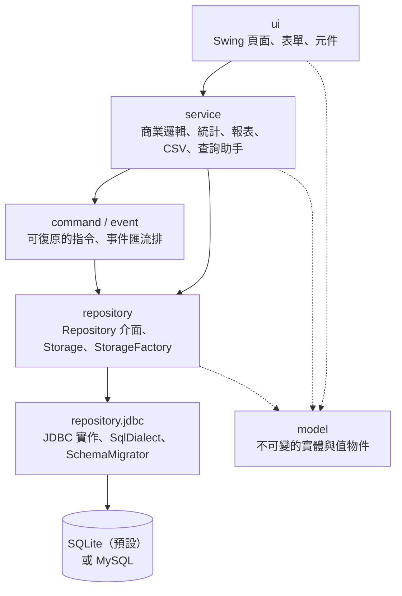
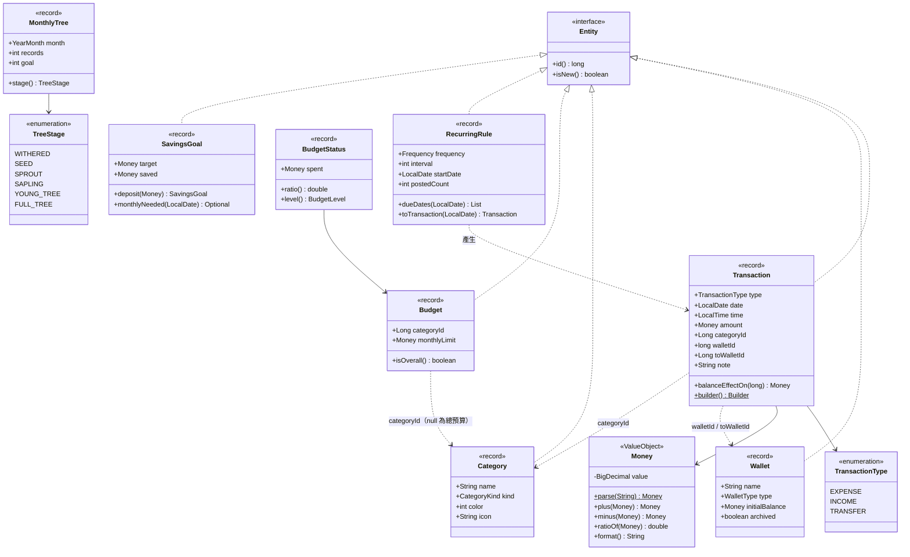
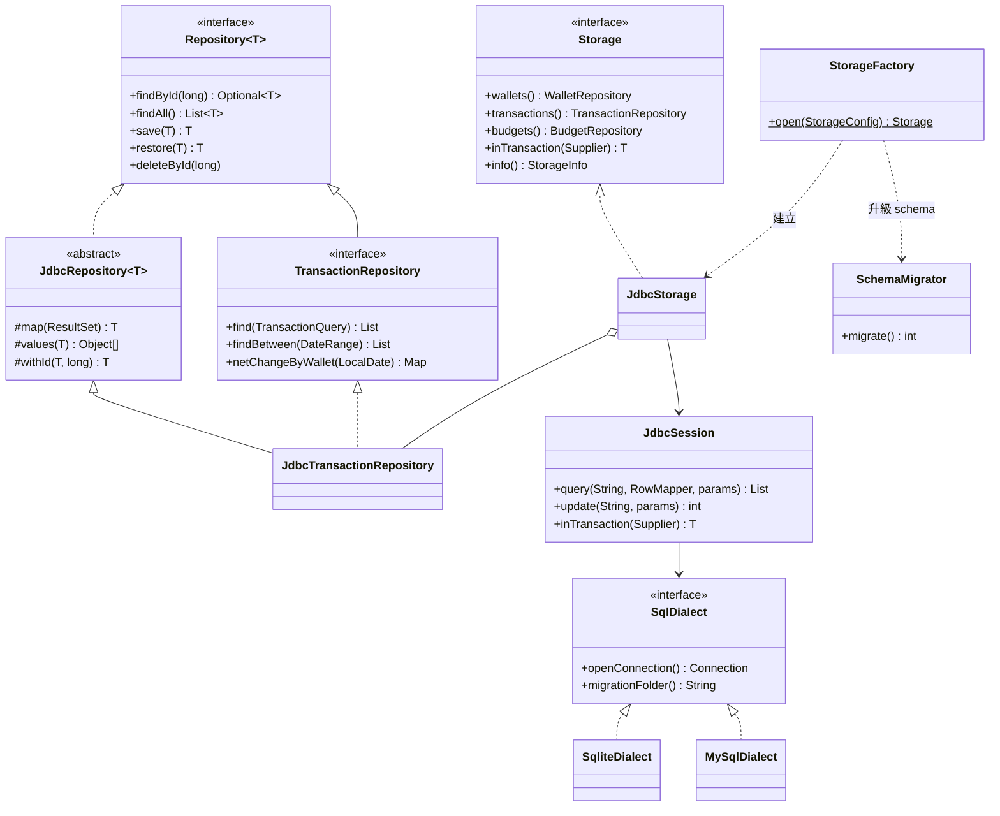
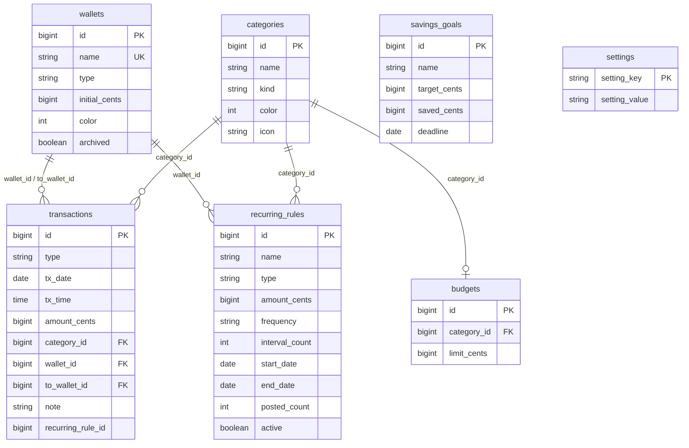
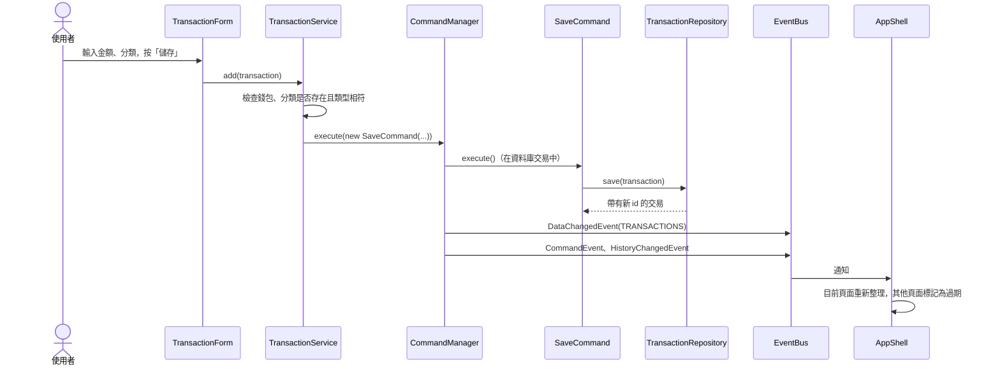
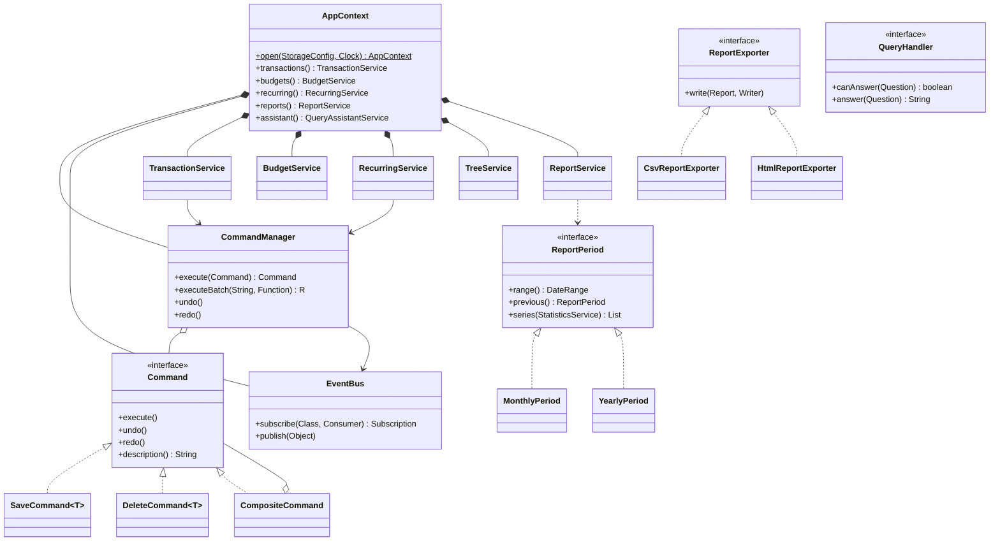
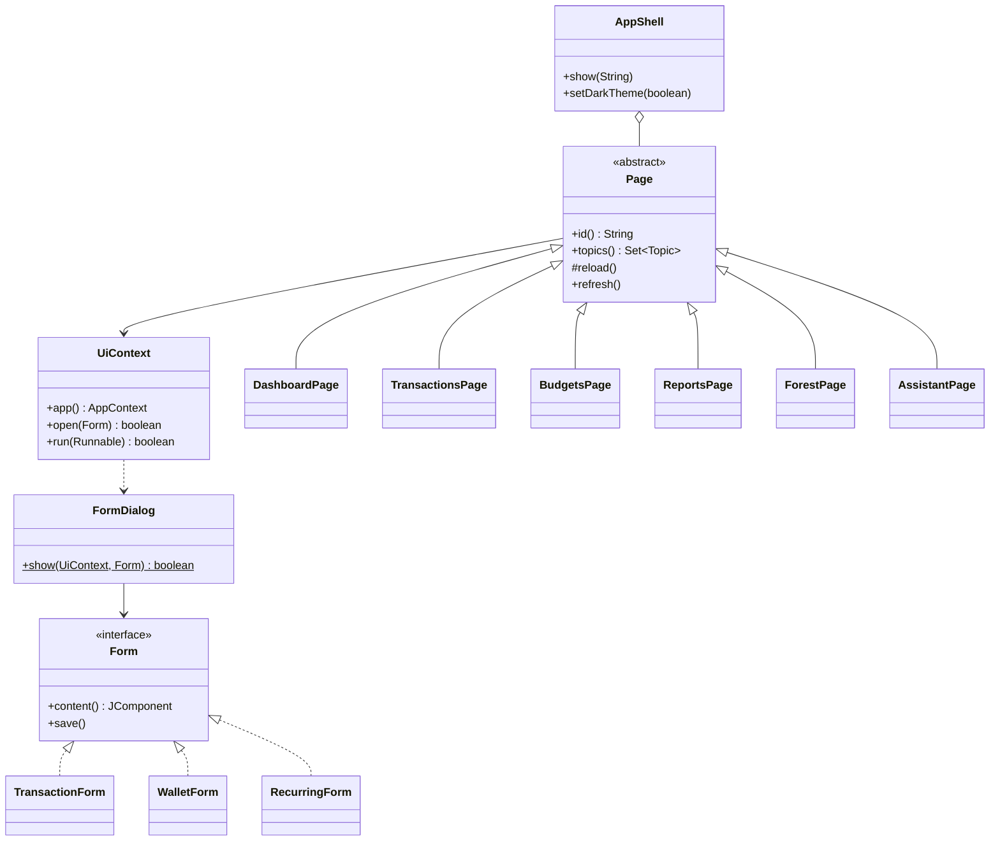

# 架構

個人記帳本分成五層，上層只依賴下層的介面：

| 套件 | 職責 | 主要類別 |
|---|---|---|
| `budgetbook.app` | 程式進入點、解析命令列參數與設定檔、headless smoke test | `BudgetBookApp`、`AppConfig`、`SmokeTest` |
| `budgetbook.model` | 不可變的實體（record）與值物件，建構時檢查資料 | `Money`、`Transaction`、`Wallet`、`Category`、`Budget`、`RecurringRule`、`SavingsGoal`、`DateRange` |
| `budgetbook.exception` | 自訂例外，訊息是給使用者看的中文 | `ValidationException`、`EntityInUseException`、`StorageException` |
| `budgetbook.repository` | 資料存取介面與資料庫設定 | `Repository<T>`、`TransactionRepository`、`Storage`、`StorageFactory` |
| `budgetbook.repository.jdbc` | 兩種資料庫共用的 JDBC 實作 | `JdbcRepository<T>`、`JdbcStorage`、`SqlDialect`、`SchemaMigrator` |
| `budgetbook.event` | 資料變更通知 | `EventBus`、`DataChangedEvent`、`HistoryChangedEvent` |
| `budgetbook.command` | 復原與重做 | `Command`、`SaveCommand`、`DeleteCommand`、`CompositeCommand`、`CommandManager` |
| `budgetbook.service` | 商業規則與計算，組合根 | `TransactionService`、`BudgetService`、`RecurringService`、`TreeService`、`AppContext` |
| `budgetbook.service.report` | 月報、年報與匯出 | `ReportService`、`ReportPeriod`、`ReportExporter` |
| `budgetbook.service.io` | CSV 匯入匯出 | `Csv`、`TransactionCsvService` |
| `budgetbook.service.assistant` | 規則式查詢助手 | `QueryAssistantService`、`QueryHandler`、`PeriodParser` |
| `budgetbook.ui` | Swing 介面，只呼叫 service | `AppShell`、`Page`、`UiContext`、`MainFrame` |

## 領域模型

所有實體都是 Java `record`：欄位不能修改，建構子檢查資料是否合法（金額必須大於 0、轉帳的兩個錢包不能相同……），
修改時建立新物件（`withName`、`toBuilder()`）。金額一律使用 `Money`，內部是兩位小數的 `BigDecimal`。

## 資料存取

service 只認得 `Storage` 與各個 `Repository` 介面。`StorageFactory` 依設定建立 SQLite 或 MySQL 的 `JdbcStorage`；
兩者共用同一份 JDBC 程式，差異（如何連線、建表 SQL）由 `SqlDialect` 處理。

### 資料表

金額以「分」為單位的整數保存（避免浮點誤差），日期與時間以 ISO 格式保存（SQLite 為文字、MySQL 為 `DATE`／`TIME`）。

### Schema 版本管理

`schema_version` 資料表記錄目前的版本。啟動時 `SchemaMigrator` 依序執行尚未套用的
`src/main/resources/db/<sqlite|mysql>/V<版本>__<名稱>.sql`，執行完再把版本寫入 `schema_version`
（SQLite 的整個版本在同一個資料庫交易中完成；MySQL 的建表指令會自動提交）。

| 版本 | 內容 |
|---|---|
| V1 | 錢包、分類、交易、設定 |
| V2 | 預算、定期交易、儲蓄目標，並在交易表加入 `recurring_rule_id` |

新增欄位或資料表時，在 `SchemaMigrator.MIGRATIONS` 加一個版本並撰寫兩種資料庫的 SQL；舊的資料庫會在下次啟動時自動升級。

## 修改資料的流程

所有修改都經過 `CommandManager`：指令在一個資料庫交易中執行，成功後放進復原歷史，再發布事件讓畫面更新。
以新增一筆交易為例：

按 Ctrl+Z 時 `CommandManager.undo()` 取出最近的指令並呼叫 `undo()`：新增的資料被刪除、修改的資料寫回舊版本、
刪除的資料以原本的 id 寫回。匯入 CSV、定期交易入帳這類一次修改多筆的操作，會合併成一個 `CompositeCommand`，一次就能復原。

## 服務與組合根

`AppContext` 是組合根：建立 `Storage`、`EventBus`、`CommandManager` 與所有 service，並以建構子注入彼此需要的物件。
需要「今天」的 service 都注入 `java.time.Clock`，測試時使用固定日期。

## 使用者介面

`MainFrame` 只負責視窗與選單，內容是 `AppShell`：左邊導覽列、中間以 `CardLayout` 切換的頁面、下方狀態列。
每個頁面繼承 `Page`，宣告自己關心的資料（`topics()`）並在 `reload()` 中向 service 取得資料；
頁面不直接存取資料庫，也不包含商業規則。`AppShell` 不依賴 `JFrame`，因此測試可以在沒有螢幕的環境中建立整個介面並畫成圖片。

切換深色模式時，`Theme` 重新套用 FlatLaf；顏色由 `Palette` 依目前主題提供，圖表在頁面重新整理時以新顏色重建。
