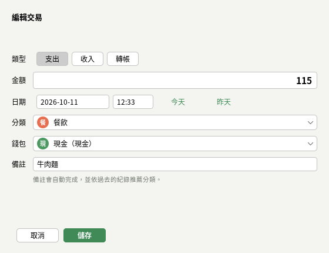

# 使用說明

## 開始使用

1. 安裝 Java 21 以上（例如 Eclipse Temurin 21）。
2. 執行 `run.bat`（Windows）或 `./run.sh`（macOS／Linux）。第一次會自動建置，之後直接開啟。
3. 第一次開啟時會建立預設的分類，以及「現金、銀行帳戶、電子支付」三個錢包，並詢問是否載入示範資料。
   示範資料是最近六個月的日常收支，可以先看看圖表、預算與森林；試用完到「設定 → 清除所有資料」重新開始。

只想看看功能、不想留下資料時，可以用示範模式開啟：`java -jar target/personal-budget-book.jar --demo`。

## 記一筆帳

按 **Ctrl+N** 或總覽右上角的「＋ 記一筆」。

- **類型**：支出、收入或轉帳。轉帳是在自己的錢包之間移動金額，例如從銀行帳戶提款到現金，不算收入也不算支出。
- **金額**：可以直接輸入算式，例如 `120+45` 或 `3*85`，離開欄位時會算出結果。
- **日期與時間**：預設是現在；在日期欄按 ↑ ↓ 可以加減一天，旁邊的「今天」「昨天」可以快速切換。
- **備註**：輸入時會用以前的備註自動完成，並依過去相同備註的紀錄自動選好分類（例如輸入「捷運」就選「交通」）。
- **儲存並新增下一筆（Ctrl+Enter）**：連續記好幾筆時使用，日期、錢包與分類會保留。

每一筆手動記下的帳都會替本月的小樹澆一次水。



## 查看與修改交易

「交易」頁列出所有紀錄：

- 上方可以依關鍵字（備註、分類或錢包名稱）、期間、類型、分類、錢包篩選；**Ctrl+F** 直接跳到搜尋框。
- 點欄位標題排序，再點一次反向排序。
- 雙擊或按 **Enter** 編輯，**Delete** 刪除（可以多選），**Ctrl+D** 把選取的交易複製到今天，右鍵有同樣的選單。
- 下方顯示目前條件下的筆數、收入、支出與淨額。

任何修改都可以用 **Ctrl+Z** 復原、**Ctrl+Y** 重做，「編輯」選單會顯示下一步要復原的內容。

## 錢包

每個錢包顯示目前餘額：初始金額加上所有相關交易。信用卡可以用負數表示欠款。

- 「轉帳」記錄錢包之間的移動，例如繳信用卡費、儲值電子支付。
- 不再使用的錢包可以「封存」：不出現在記帳選單，但保留歷史紀錄；只有沒有任何交易的錢包可以刪除。
- 下方的折線圖是近 90 天所有錢包的總額。

## 分類

支出與收入各有一組分類，可以自訂名稱、顏色與圖示文字（一到兩個字，可以是中文字、符號或 emoji）。
已經有交易的分類不能直接刪除，可以先用「合併到…」把交易移到其他分類，合併後原分類會被刪除。

## 預算

在「預算」頁設定：

- **每月總預算**：一個月最多想花多少。
- **分類預算**：例如餐飲每月 7,000 元，按每一列右邊的「設定」。

預算每個月自動套用。使用率 80% 以上顯示橘色，超過 100% 顯示紅色，總覽頁也會列出最需要注意的幾項。
本月的總預算會依目前的花費速度預估月底支出。上方的 ◀ ▶ 可以查看以前月份的預算使用情況。

## 定期交易

房租、薪資、手機月租、訂閱服務等固定收支，在「定期」頁新增一次就好：

- 週期可以是每天、每週、每月或每年，並設定間隔（例如每 2 週）。每月 31 日開始的規則在小月會落在月底。
- 程式啟動時會自動入帳所有已到期的定期交易，狀態列會顯示入帳了幾筆，整批可以用 Ctrl+Z 復原。
- 「立即入帳下一次」提早記下下一期，「略過一次」跳過下一期，也可以暫停或設定結束日期。
- 右邊列出接下來 30 天預定的交易。

定期交易自動產生的紀錄不算替小樹澆水，因為那不是自己記的帳。

## 儲蓄目標

為旅行、學費或緊急預備金建立目標，設定目標金額與日期。「存入」「取出」只是標記這筆錢的用途，
錢仍在原本的錢包裡，不會產生交易。有目標日期時，會計算每個月平均還需要存多少。

## 報表

「報表」頁可以切換月報與年報：

- 收入、支出、結餘、儲蓄率，以及和上一期的比較。
- 支出分類的甜甜圈圖與明細表。
- 月報顯示每日支出，年報顯示每月收入與支出。
- 該期間的資產趨勢。

「匯出 CSV」可以用 Excel 或 Google 試算表開啟；「匯出 HTML」可以用瀏覽器開啟、列印或另存成 PDF。

## 匯入與匯出 CSV

「檔案 → 匯出全部交易 CSV」（**Ctrl+E**）或交易頁的「匯出 CSV」（只匯出目前篩選的結果）。檔案使用 UTF-8，欄位如下：

```text
日期,時間,類型,金額,分類,錢包,轉入錢包,備註
2026-10-28,12:30,支出,120,餐飲,現金,,牛肉麵
2026-10-24,12:30,轉帳,4250,,薪轉帳戶,信用卡,繳信用卡費
```

「檔案 → 匯入交易 CSV」（**Ctrl+I**）可以匯入同樣格式的檔案，也接受英文標題
（`date,time,type,amount,category,wallet,to_wallet,note`）與任意的欄位順序：

- 日期可以寫成 `2026-10-28` 或 `2026/10/28`，時間可以空白。
- 沒有「類型」欄時，負數金額視為支出、正數視為收入。
- 不存在的錢包與分類會自動建立。
- 和資料庫中完全相同的交易（日期、時間、類型、金額、錢包、分類、備註都相同）會略過，重複匯入同一個檔案不會多出資料。
- 匯入前會顯示將匯入幾筆、略過幾筆與格式錯誤的行號；匯入後可以用 Ctrl+Z 整批復原。

## 我的森林

「森林」頁顯示本月的小樹與過去每個月的樹。每記一筆帳就是澆一次水，小樹依本月澆水次數成長：

| 本月澆水次數（目標 20 次時） | 階段 |
|---|---|
| 0 | 枯萎 |
| 1～4 | 種子 |
| 5～9 | 發芽 |
| 10～14 | 幼苗 |
| 15～19 | 小樹 |
| 20 以上 | 大樹（完成一棵樹） |

上方也顯示完成的樹的數量、目前連續記帳的天數與最長紀錄。今天還沒記帳時，只要昨天有記，連續天數就還在。
每月目標可以在「設定」調整（5～100 次）。

## 查詢助手

在「助手」頁用中文發問，或點下方的常用問題，例如：

- 本月花最多的是哪個分類？
- 上個月餐飲花了多少？
- 預算還剩多少？
- 跟上個月比，支出增加了嗎？
- 現金還有多少？
- 日本旅行還差多少？
- 接下來有哪些定期扣款？

時間可以說今天、昨天、本週、上週、本月、上個月、3 月、2026 年 5 月、最近 30 天、今年、去年。
助手以規則判斷問題，答案都是從自己的記帳資料計算出來的，不會連線到外部服務。

## 鍵盤快捷鍵

macOS 上的 Ctrl 換成 Command。按 **F1** 可以隨時查看。

| 按鍵 | 功能 |
|---|---|
| Ctrl+N | 新增交易 |
| Ctrl+T | 新增轉帳 |
| Ctrl+Z | 復原 |
| Ctrl+Y／Ctrl+Shift+Z | 重做 |
| Ctrl+F | 搜尋交易 |
| Ctrl+1 … Ctrl+0 | 切換到第 1～10 頁（總覽、交易、錢包……助手） |
| Ctrl+I／Ctrl+E | 匯入／匯出交易 CSV |
| Ctrl+Shift+D | 切換淺色／深色模式 |
| Enter／Delete／Ctrl+D | 交易表格中：編輯／刪除／複製到今天 |
| Ctrl+Enter | 交易視窗中：儲存並新增下一筆 |
| ↑ ↓ | 日期欄加減一天，時間欄加減五分鐘 |
| Esc | 關閉對話框 |

## 資料庫設定

資料預設存在 `~/.budgetbook/budgetbook.db`（SQLite），備份時複製這個檔案即可，也可以定期匯出 CSV。
「設定」頁顯示目前使用的資料庫、位置與 schema 版本。

改用 MySQL 時建立 `~/.budgetbook/budgetbook.properties`：

```properties
storage=mysql
mysql.url=jdbc:mysql://localhost:3306/budget_book?createDatabaseIfNotExist=true&useUnicode=true&characterEncoding=utf8&serverTimezone=Asia/Taipei&allowPublicKeyRetrieval=true&useSSL=false
mysql.user=root
mysql.password=你的密碼
```

資料表會在第一次連線時自動建立。MySQL 無法連線時，程式會詢問是否改用內建的 SQLite。
其他設定方式（命令列參數、環境變數）見 README 的「資料庫」一節。
